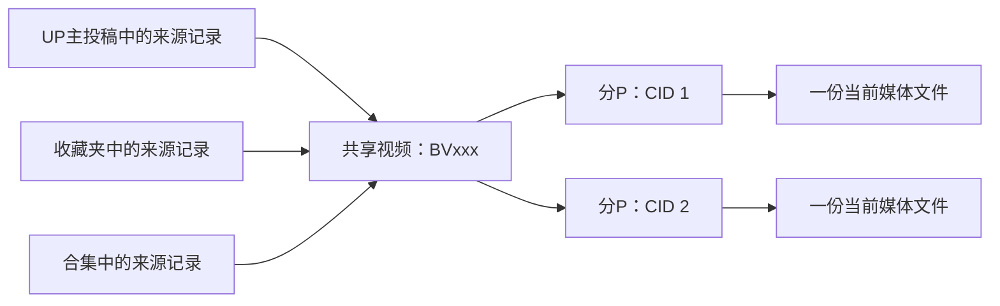

# 按 BV 共享视频存储

状态：待实施设计。当前已经实现主投稿者过滤和按 BV 计算视频数量；尚未实施跨来源共享媒体，也未迁移、合并或删除已有文件。

## 目标与约束

同一视频出现在 UP 主投稿、收藏夹、合集和稍后观看中时，只保留一份媒体，所有来源引用它。来源仍保留各自的名称、过滤设置、选择的投稿、收藏时间、扫描进度和启用状态。

- 普通视频的逻辑身份是完整的 BV 号，严格按原值比较，不根据标题、文件名或作者昵称合并。
- 一个 BV 可以有多个分 P。实际媒体文件的身份是 `(bvid, cid)`，每个分 P 保留一个当前版本；不能把同 BV 的 P1 和 P2 当成重复文件删除。
- 主投稿者来自视频详情的 `owner.mid`。协作者单独保存名字、UID、角色和顺序，仅用于展示、元数据和协作统计，其过滤规则不能影响该视频。
- 稳定状态下，每个媒体分 P 只有一个当前完整文件。下载、升级和迁移期间允许临时文件，以免覆盖唯一可用的完整文件。
- 番剧保留 `ep_id`、季度、集号等展示关系。本仓库已有专门支持同 BV 不同 `ep_id` 的索引迁移；因此不能把现有 `video` 表直接改为仅 `UNIQUE(bvid)`。番剧媒体只有在 BV 和 CID 都确认一致时才共享，缺失身份的记录先保留。

## 当前重复的来源

`m20250914_000001_fix_video_unique_index_for_bangumi.rs` 中的唯一键包含来源列、BV 和 `ep_id`，所以不同来源能合法插入多个相同 BV。`utils/model.rs::create_videos` 的去重还受到 `video_source.filter_expr()` 限制，只在一个来源内起效。

`workflow.rs::download_video_pages` 根据来源路径和模板生成目标路径，再由 `fetch_page_video` 下载文件。`page.path` 最终记录这份来源专属的文件。

删除逻辑同样按来源拥有文件设计：`delete_video_files_from_pages` 删除该行指向的媒体，`delete_video_source_internal` 还会递归删除视频目录。仅让多个 `page.path` 指向同一个路径，会使删除一个来源破坏其他来源。

## 数据模型

保留现有 `video.id` 作为兼容的来源记录 ID，新增独立的共享媒体层。这样旧链接、来源关系和历史任务不会在升级时失去指向。

| 表/关系 | 关键约束 | 职责 |
| --- | --- | --- |
| `media_video` | `id` 主键，`bvid UNIQUE NOT NULL` | 全局视频身份、主投稿者 UID、公共标题与元数据、全局删除状态 |
| `media_creator` | `(media_video_id, uid) UNIQUE`；每个视频至多一个主投稿者 | 作者姓名、UID、角色和顺序；主投稿者和协作者分开 |
| 现有 `video` | 新增 `media_video_id` 外键，保留现有来源唯一键 | 来源成员关系、收藏时间、选择状态、过滤结果、展示名称及来源删除状态 |
| `media_part` | `(media_video_id, cid) UNIQUE` | 分 P 身份、当前文件引用、下载状态、租约/发布代次 |
| 现有 `page` | 新增 `media_part_id` 外键 | 来源中的分 P 顺序、展示信息，以及是否满足该来源的过滤规则 |
| `media_file` | 一个 `media_part` 只允许一个 active 版本 | 受管理路径、长度、校验值、实际编码/质量、完整性、状态 |
| `media_view` | 受管理的展示路径唯一 | 来源目录中的链接/元数据文件，引用对应 `media_file` 和来源记录 |
| `storage_operation` | 唯一操作 ID，记录阶段及预期文件身份 | 迁移、发布、替换、垃圾回收的可恢复日志 |

`video` 和 `page` 在此模型中是来源视图，多个来源记录并不代表多份媒体。公共作者信息和媒体状态以共享表为准；现有字段可在过渡期作为兼容缓存，不能再独立决定文件是否存在或可删除。

初期新增的外键允许为空，以兼容未迁移记录。新下载必须走共享存储服务。不可将未知 BV/CID 合并到空字符串或 `0` 的公共记录；未知身份保持待解析状态。



## 路径与媒体库兼容

新增应用级共享媒体目录 `media_library_path`，当前文件按稳定身份定位，例如：

```text
<media_library_path>/<bvid>/<cid>/video.mp4
```

共享媒体目录独立于任何一个来源。修改来源名称、删除来源、修改来源保存路径、主投稿者改名，都不移动或删除共享媒体。

现有来源保存路径转为展示目录，仍可按原模板生成可读的文件名：

1. 同一文件系统优先使用硬链接，来源目录中的 `.mp4` 不增加一份媒体数据。
2. 不同文件系统使用符号链接，需要检查权限及媒体服务器能否访问目标。不可硬链接时绝不静默退化为复制媒体。
3. 不支持链接的环境直接使用共享媒体目录和应用内虚拟来源视图，并显示该来源展示目录不可用。媒体仍下载一次，展示失败与下载失败分开报告。

展示链接必须登记在 `media_view`，不能靠扫描目录猜测所有权。升级媒体时，原硬链接仍指向旧文件，必须按日志逐个替换链接，确认旧版本无受管理引用后才能回收。符号链接目标、硬链接身份、Windows/NAS/Docker 下的能力需要实际验证。

公共封面、字幕和 NFO 由共享视频生成一次。需要合集名称或排序等来源特定信息时，可以生成少量来源专属 NFO，但不能复制视频媒体。NFO 始终写入分开的作者名字和角色，不用 UID 作为姓名。

## 扫描、过滤与下载

扫描流程：

1. 解析 BV，在短事务内 UPSERT `media_video`，创建或更新该来源的 `video` 记录，并关联共享视频。
2. 解析详情后确认主投稿者、协作者和各分 P 的 CID；UPSERT `media_part`，将来源的 `page` 关联到对应媒体分 P。
3. 根据每个来源的规则和选择状态记录是否需要下载；公共视频元数据不因某个来源过滤失败而丢弃。
4. 已有完整可用媒体时只建立展示引用；新增收藏夹或合集不会重新下载相同 BV/CID。

过滤的合并规则：

```text
某分P需要下载 = 没有全局删除标记
             AND 主投稿者过滤允许
             AND 至少一个启用来源选择该视频且该分P满足其来源过滤
```

收藏夹过滤拒绝、投稿源过滤允许时，投稿源仍可下载；反之亦然。主投稿者过滤统一约束这个作者的视频，防止换一个收藏夹又重复下载被排除的视频。协作者过滤不参与判断。

禁用来源只停止扫描和新增下载需求，不能释放已有保留引用。来源筛选变化也不直接删除已有文件；清理页面展示不再满足规则的媒体及仍在保留它的来源，再执行指定的清理操作。

下载任务以 `media_part_id` 去重，不能继续以来源 `video.id/page.id` 为互斥单位。多个来源同时发现同一个分 P 时只有一个任务下载，其他来源等待共享结果。

- 进程内按媒体分 P 加锁；数据库唯一约束及带代次的租约负责持久状态，避免重启和并发产生重复任务。
- 网络下载期间不持有长数据库写事务。
- 暂存路径包含操作 ID；aria2 任务、重试和取消都属于共享媒体任务。
- 发布操作由媒体文件锁串行化，获取锁后重新校验租约代次，过期任务不能覆盖新任务结果。
- 完整性检查后原子发布，再提交 active 文件引用；文件操作和数据库无法作为一个事务，因此发布前记录操作日志，启动恢复根据日志完成或撤销未完成的发布。
- 存在路径不代表下载成功；必须同时检查数据库状态和文件完整性。未完成、零长度或损坏文件不能被复用。
- 一个来源移除或取消，不会中断仍被其他来源请求的共享下载；全局暂停可以暂停共享任务。

当前视频质量和编码设置是应用级配置，因此沿用一份应用级媒体选择策略。已有不同质量副本不能简单按大小决定保留谁：先从数据库及上游元数据确认 BV/CID 对应关系，再通过媒体探测核对完整性、时长、编码、分辨率和音轨，选择符合当前策略的版本。媒体探测不能单独从文件内容反推出 CID，缺失或矛盾的身份映射必须保留为冲突。质量升级替换共享版本，所有来源同时看到新版本；不同来源不再各留一份质量版本。无法确认等价或兼容的旧副本作为迁移冲突保留，待明确选择后处理。

## 删除、恢复与清理统计

区分以下操作，不让“从收藏夹移除”和“删除全库媒体”共用不明范围的删除入口。

| 操作 | 结果 |
| --- | --- |
| 从某来源移除视频 | 删除/隐藏成员关系及该来源的展示引用，保留其他来源 |
| 删除来源并保留文件 | 解除来源关系，建立独立保留标记，使未归属来源的媒体仍可在库中管理 |
| 删除来源并清理文件 | 解除成员关系，仅回收没有其他保留来源、独立保留标记或活动任务的媒体 |
| 从全库删除视频 | 展示受影响的全部来源，设置共享视频删除标记，清理所有受管理展示引用，再回收媒体 |
| 恢复来源中的视频 | 恢复成员关系；媒体还存在则复用，不重置其他来源的完成状态 |
| 恢复全库视频 | 清除全局删除标记，按当前有效下载需求重新调度 |

来源的 `scan_deleted_videos` 可恢复来源成员关系，但不能隐式清除全局删除标记；全库删除需要显式恢复，避免下一次扫描立刻重新下载。

保留判断必须从当前成员关系、独立保留标记、活动任务计算，不能仅依赖可能失真的整数引用计数。回收过程按共享媒体加锁，在短事务内复查引用并进入 retiring 状态；新的来源引用需等待或使回收取消。删除文件后提交最终状态，失败则保留可重试日志。

所有删除入口必须改用统一存储服务，包括 API 立即删除、后台删除队列、视频源删除、下载前自动清理、重置路径及失败重试清理。共享目录禁止使用来源级 `remove_dir_all`。只能删除登记的具体文件或链接，再清理确认无其他成员的空目录。

清理页面提供：

- 全库视频数：共享 BV 数，不因来源数增加。
- 主投稿者占用：其主投稿视频的不同 active 媒体文件之和，一个 BV/CID 计算一次。
- 协作统计：独立展示，标明共享归属，不能重复加进全库总量。
- 来源逻辑体积：该来源可访问的媒体体积，允许与其他来源重叠。
- 可释放空间：所选操作执行后确实失去全部保留引用的文件；删除一个还有其他来源的引用时为 0。
- 迁移重复占用：仍未合并的独立物理文件。已有硬链接不当作重复副本；不同质量冲突单独列出。

显示文件长度和可获得的实际分配空间时明确区分；不能以 BV 数量去重推断物理空间已释放。检测到不受管理的硬链接时不保证物理回收估计。

## 已有库迁移

迁移按可恢复任务实施，普通数据库升级只增加表和关联字段，不自动删除文件。

1. 暂停涉及文件的下载、移动、删除任务，取得库级排他锁，备份数据库，并生成操作日志。执行期间不运行旧版程序或其他不理解共享存储的写入进程。
2. 读取所有来源记录与分 P，按 BV/CID 建立共享身份。保持旧来源记录 ID，生成旧页 ID 到共享分 P 的映射；旧待处理任务在执行前转换并复查。
3. 列出每个 BV/CID 的文件路径、物理文件身份、长度、完成状态及媒体探测结果。相同路径和硬链接只算一份。缺失 CID、离线磁盘、不可读文件、矛盾作者信息、不同剪辑或质量不确定的组标为冲突，保留原数据。
4. 为可处理组确定保留版本，生成预览：保留路径、各来源、将替换的副本、展示方式、预计释放空间和阻塞项。不能根据较小数据库 ID 或最大文件长度盲选。
5. 将保留版本放入共享目录。同卷可先建立硬链接；跨卷先复制到暂存区，核对完整文件校验值和媒体探测结果，发布成功后才移除旧副本。身份一致不代表内容逐字节一致；不同质量的处理必须符合明确的保留策略。
6. 先建立并验证各来源的共享关联和展示引用，再按日志逐个替换旧路径。每次替换前复核文件身份、长度及变更时间，发现并发修改即停止该组。
7. 只有共享文件和引用都可用后才能删除被取代的独立副本。暂存/备份中的副本也占空间，未实际删除前不得报告已经释放。保留数据库映射和操作日志，用于重试和审计。
8. 校验来源数量、唯一 BV/CID 数、完整媒体可读性、播放预览和删除边界后恢复调度。中断重跑必须复用日志中的结果，不能再次下载或重复删除。

迁移前可以取消或回退未删除原副本的操作。旧副本删除后，回退旧存储布局需要依据日志重新物化来源文件，可能重新占用重复空间；不能承诺仅回滚 SQL 即可恢复旧版运行。

## 实施顺序与验收

1. 新增共享实体、兼容外键和存储服务；覆盖唯一身份、作者身份与引用计算。
2. 把全部播放、删除、恢复、重置、路径变更和后台任务接到存储服务；在任何共享文件发布前完成删除保护。
3. 把新扫描和下载改为全局 BV/CID 查找、共享调度与发布，保留来源独立筛选状态。对未迁移的旧文件先发现可复用副本，不能因共享表暂空而再下载一份。
4. 增加旧库迁移预览、冲突处理、操作日志和断点恢复。
5. 清理页面改为共享媒体统计，视频列表按 BV 分组并显示所有来源，保留旧 ID 链接兼容。

必须通过的端到端场景：

- 同 BV 同时从投稿、两个收藏夹及合集进入：一条共享视频记录，每个 CID 下载一次，四个来源均可播放。
- 同 BV 不同 CID、同 BV 不同番剧 `ep_id`：分 P 和节目关系不丢失；只共享确实相同的媒体。
- A 来源拒绝、B 来源允许：B 能下载；主投稿者拒绝则所有来源都跳过；协作者规则不改变结果。
- 删除任意一个来源，其余来源仍可播放；最后一个引用删除、保留文件模式及全局删除/恢复分别正确处理。
- 下载/删除并发、租约过期、进程中断、磁盘不足：不重复发布、不删除仍被引用的媒体、不让旧任务覆盖新结果。
- 已有两份完整副本、一份损坏副本、不同质量副本、硬链接、离线卷：正确区分可迁移项和冲突，不丢文件。
- 同卷硬链接、跨卷链接失败、Windows 权限限制、NAS/Docker 路径可见性：不静默复制大文件，准确报告展示状态。
- 媒体升级后所有受管理硬链接切换到新版本，旧版本确实可回收；来源名/作者改名不触发重新下载。
- 再次扫描、重启及迁移重跑：媒体文件数和占用不随来源数继续增长。
