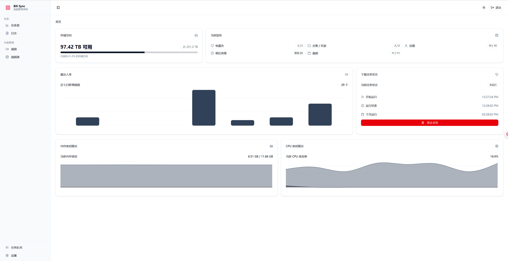
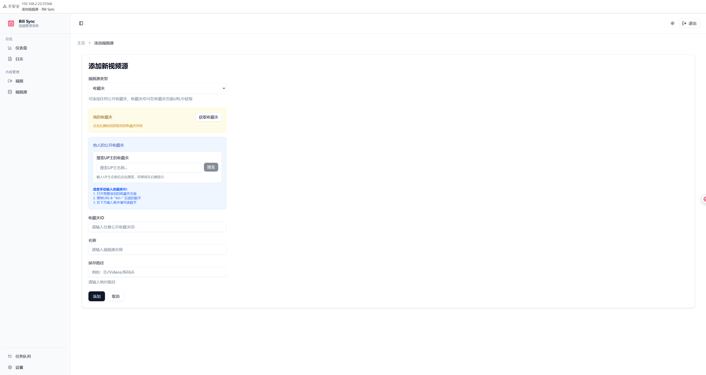
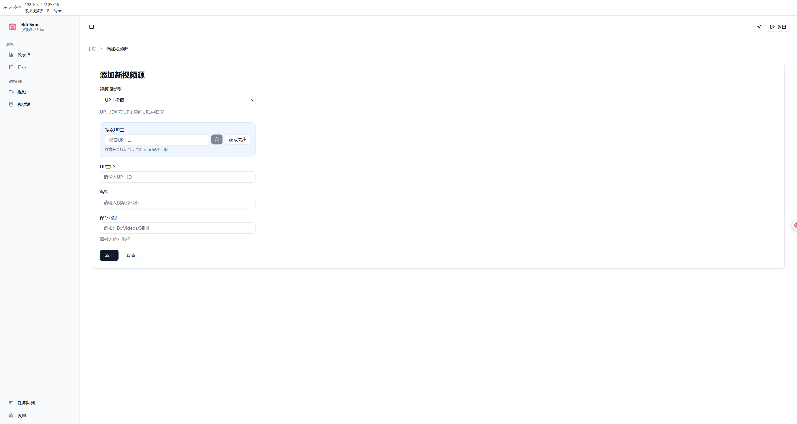
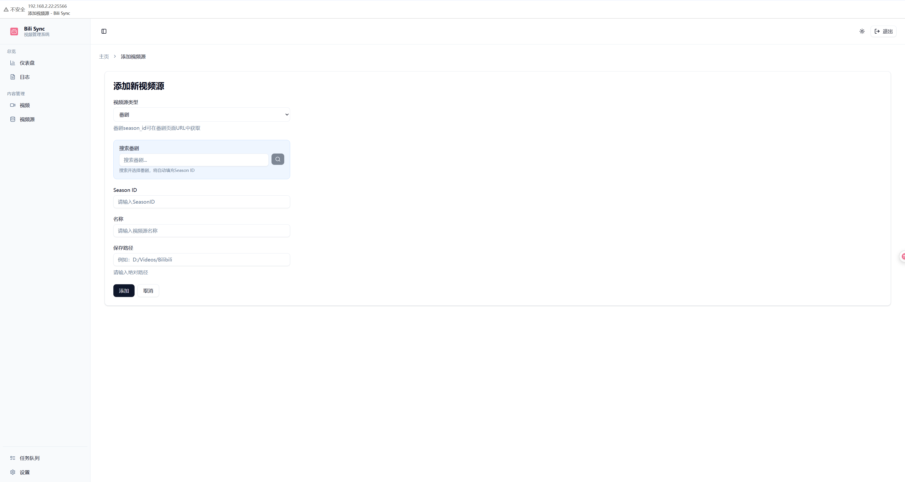
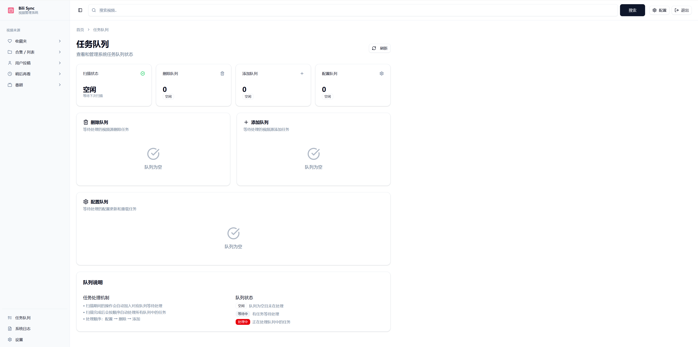
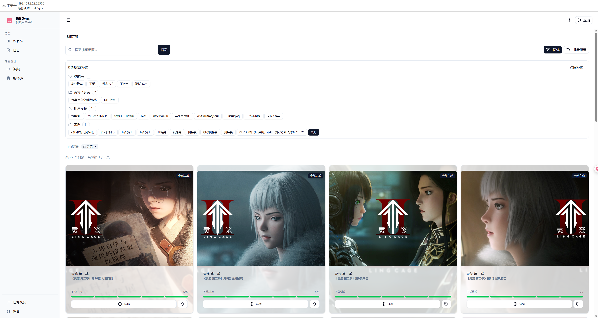
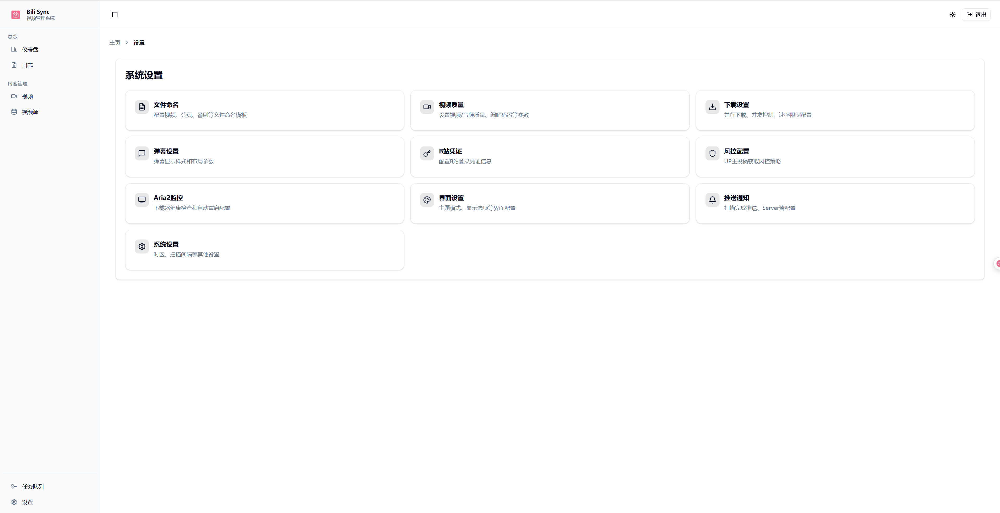

# 使用教程

## 1. 首次登录

打开浏览器访问 `http://localhost:12345`

## 2. 扫码登录

点击右上角头像 → 扫码登录 → 使用B站APP扫码

## 3. 添加下载源

### 添加收藏夹
1. 点击"添加视频源"
2. 选择"收藏夹"
3. 选择要下载的收藏夹
4. 点击确定

旧版本保存的收藏夹短ID会在扫描前自动核对当前账号创建和关注的收藏夹。找到唯一匹配后，原视频源会迁移为完整ID并保存创建者UID，保留下载记录、保存路径、过滤设置及扫描进度；同次扫描即使用完整ID，后续扫描无需重复查找。

自己的收藏夹无需手动修复：登录原账号后，扫描会通过收藏夹信息自动恢复完整ID和名称。即使收藏夹为空、本地没有下载记录，或视频列表暂时不可用，也会先保存已验证的完整ID。

如果未登录、列表读取失败、找不到匹配或存在多个匹配，本次扫描会保留原记录并提示修复，不会用未经确认的ID覆盖名称或读取其他收藏夹。请在视频源页面打开「修复收藏夹ID」，粘贴B站原收藏夹的完整URL。即使当前ID已经完整，也可通过该URL完成身份验证；没有关注的公开收藏夹同样适用。名称确实为「默认收藏夹」的收藏夹可以正常使用。

也可以在「添加视频源」页面找到标记为已添加的收藏夹，点击「修复原视频源」。页面会填入所选收藏夹的完整ID，确认后修复原视频源，保留已有下载记录和设置。自动查找同时支持旧短ID和已保存的完整ID；关注列表中的视频合集不会参与收藏夹身份匹配。

### 添加UP主
1. 点击"添加视频源"
2. 选择"UP主"
3. 输入UP主ID或主页链接
4. 点击确定

### 添加番剧
1. 点击"添加视频源"
2. 选择"番剧"
3. 输入番剧链接
4. 选择要下载的季度

## 4. 查看下载进度

- 首页显示实时下载进度
- "任务队列"页面查看详细状态

## 5. 管理已下载视频

- "视频"页面查看所有已下载内容
- 支持搜索、筛选、播放
- 可以删除不需要的视频

## 6. 系统设置

点击"系统设置"可以配置：
- 下载路径
- 扫描间隔
- 视频质量
- 并发数量

## 小技巧

- 支持批量添加多个收藏夹
- 番剧支持选择特定季度下载
- UP主视频支持按时间过滤
- 所有下载任务都支持暂停/恢复
- 添加视频源时会记住上次保存路径，重复配置更省时
